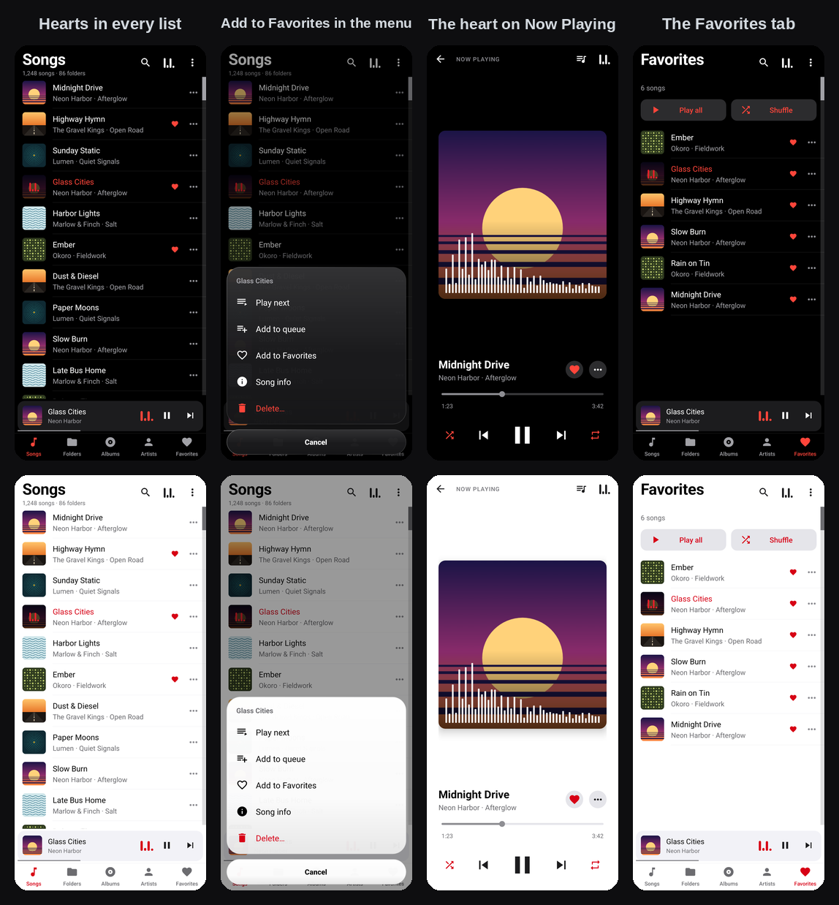
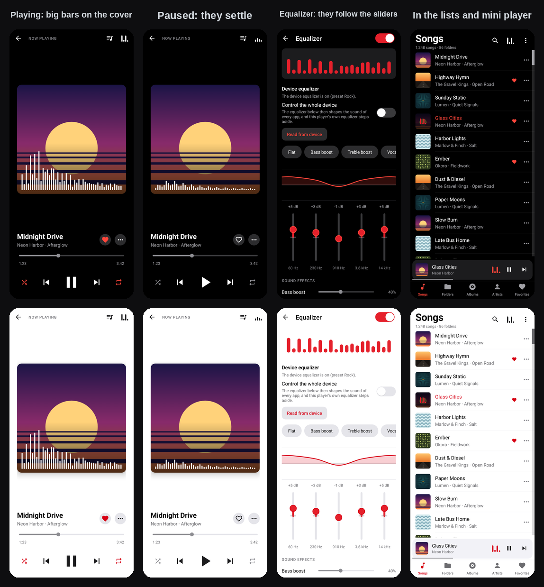
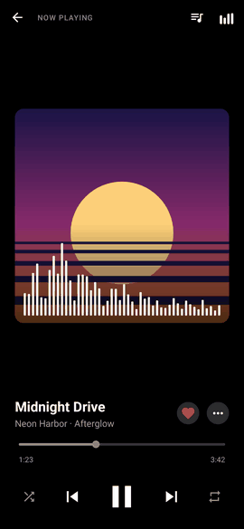
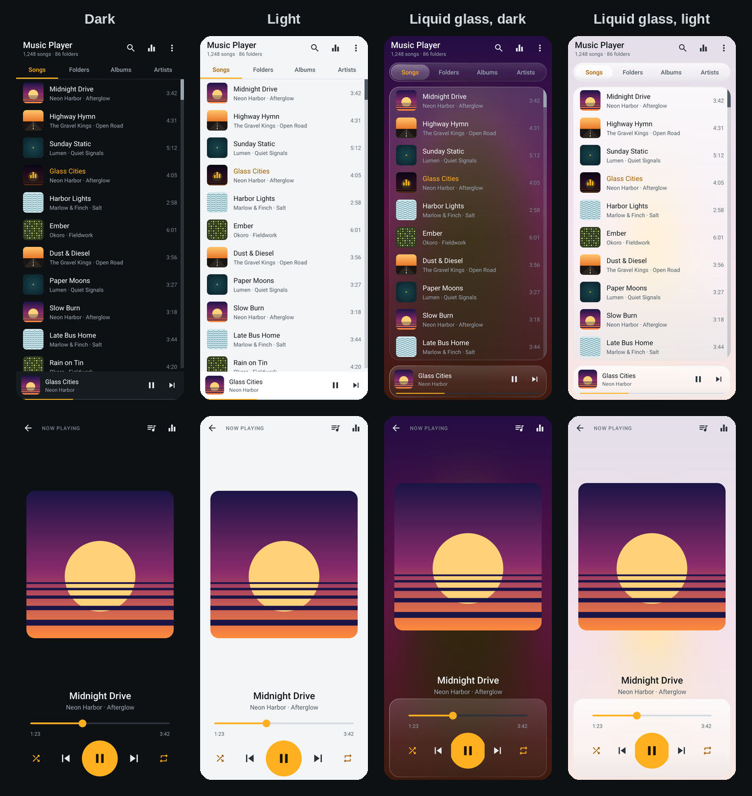
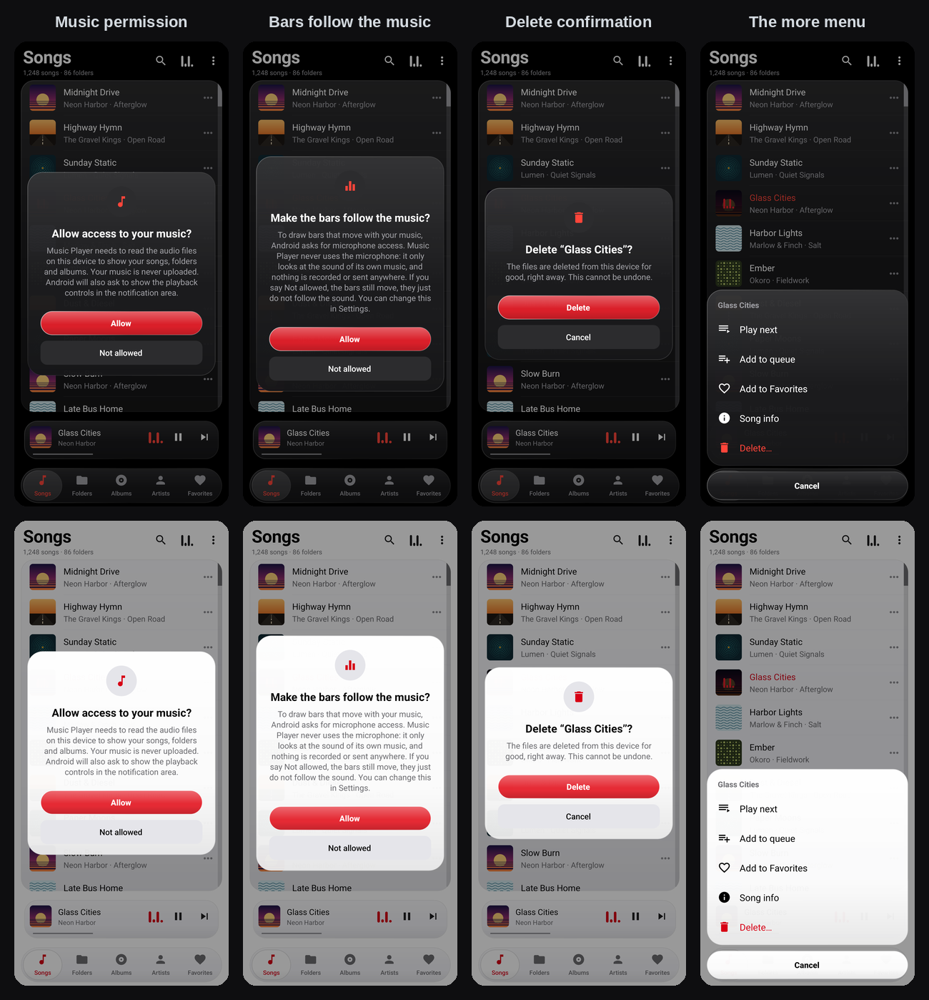
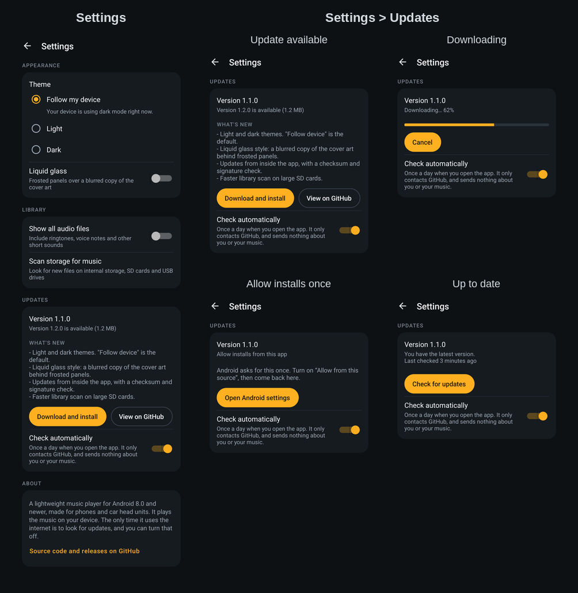

# Music Player

**A small, fast music player for Android phones and car stereos.** 
Looks like Apple Music &nbsp;·&nbsp; every folder &nbsp;·&nbsp; favorites &nbsp;·&nbsp; an equalizer with moving bars &nbsp;·&nbsp; updates itself

 

 

  

## Download

| | |
|---|---|
| **Latest version** | **1.7.1**, 13 November 2026 · [what's new](#whats-new) |
| **Get it** | [**MusicPlayer.apk**](https://github.com/mbnetworku/MusicPlayer/releases/latest/download/MusicPlayer.apk) · 171 KB · Android 8.0 or newer |
| **This exact file** | [MusicPlayer-1.7.1.apk](https://github.com/mbnetworku/MusicPlayer/releases/download/v1.7.1/MusicPlayer-1.7.1.apk) · SHA-256 [`40865cbccee4…`](https://github.com/mbnetworku/MusicPlayer/releases/download/v1.7.1/MusicPlayer-1.7.1.apk.sha256) · signed with the owner's own key |
| **All versions** | [the `download` folder](https://github.com/mbnetworku/MusicPlayer/tree/main/download) · [version history](#versions) |

**Install it in three steps**

1. **Download** the APK on your phone with the button above. For a car head unit, download it on a computer and copy it to a USB stick.
2. **Open the file.** Android asks once to allow installing from your browser or file manager (*Install unknown apps*): allow it. This is normal for apps that do not come from the Play Store.
3. **Open Music Player** and allow access to your music. That is the only permission it asks for at first.

Good to know:

* Every APK on this page is signed with the same test key, so a newer one installs **over** an older one and keeps your settings. If Android says *App not installed*, uninstall the old copy first (the very first test builds used another key).
* It is a test build: signed with a test key and checked by 307 automated tests, but not yet tried on many real phones and car stereos. See [Status and limits](#status-and-limits).
* From a computer you can also use `adb install -r MusicPlayer.apk`.

## What's new

**1.7.1**: the first version signed with your own key. Uninstall the old app once, then install this one; later updates install over it.

**1.7.0**: no microphone permission; vibration on taps and an optional pulse while music plays (Settings)

**1.6.0**: tap the cover to skip (Settings)

**1.5.0**: sort your songs (menu, Sort songs)

**1.4.0**: pick the equalizer design in Settings (Bars, Dots, Mirror or Wave)

**1.3.1**: taps work again

* Tapping a song, a folder, an album or an artist did nothing on Android 8 and newer, in every orientation. That is fixed. It began in version 1.2.0, so please update if you installed 1.2.0 or 1.3.0.
* A song no longer stays silent when Android refuses the sound to the app, as some car stereos do. If a phone call has the sound, the song waits and starts when the call ends.

**1.3.0**: favorites and moving bars

* **Favorites:** a heart on the Now Playing screen and in every song's menu, a **Favorites** tab with Play and Shuffle, and a small heart on favorite songs in every list.
* **Moving equalizer bars:** big, thin bars over the cover on Now Playing, tall for bass and short for treble. Small ones on the song that is playing, in the mini player and as the Equalizer button. They can follow the real sound (Android calls that permission "microphone"; the app never uses the microphone), or move on their own.

The full list is in the [changelog](CHANGELOG.md).

## Versions

| Version | Date | Download | What changed |
|---|---|---|---|
| **1.7.1** (latest) | 2026-11-13 | [MusicPlayer-1.7.1.apk](https://github.com/mbnetworku/MusicPlayer/releases/download/v1.7.1/MusicPlayer-1.7.1.apk) | Same app as 1.7.0, built on GitHub and signed with the owner's own key. Uninstall the old app once. |
| 1.7.0 (test key) | 2026-11-13 | [MusicPlayer-1.7.0.apk](https://github.com/mbnetworku/MusicPlayer/raw/main/download/MusicPlayer-1.7.0.apk) | No microphone permission any more. Vibration on taps, and an optional soft pulse while music plays. |
| 1.6.0 | 2026-11-12 | [MusicPlayer-1.6.0.apk](https://github.com/mbnetworku/MusicPlayer/raw/main/download/MusicPlayer-1.6.0.apk) | Tap the left or right of the cover to skip songs (turn it on in Settings). |
| 1.5.0 | 2026-11-12 | [MusicPlayer-1.5.0.apk](https://github.com/mbnetworku/MusicPlayer/raw/main/download/MusicPlayer-1.5.0.apk) | Sort your songs by title, artist, album, recently added or length, and reverse the order. |
| 1.4.0 | 2026-11-12 | [MusicPlayer-1.4.0.apk](https://github.com/mbnetworku/MusicPlayer/raw/main/download/MusicPlayer-1.4.0.apk) | Choose the equalizer design: Bars, Dots, Mirror or Wave. |
| 1.3.1 | 2026-11-12 | [MusicPlayer-1.3.1.apk](https://github.com/mbnetworku/MusicPlayer/raw/main/download/MusicPlayer-1.3.1.apk) | Taps on songs, folders, albums and artists work again. Plays on car stereos that refuse the sound. |
| 1.3.0 | 2026-11-12 | withdrawn | Favorites and moving bars. Taps on rows did not work: use 1.3.1. |
| 1.2.0 | 2026-11-12 | withdrawn | The Apple Music look, glass pop-ups, delete, device equalizer, widget. Taps on rows did not work: use 1.3.1. |
| 1.1.0 | 2026-11-11 | replaced | Light and dark themes, liquid glass, in-app updates. |
| 1.0.0 | 2026-11-11 | replaced | First version. |

Each new version is added here, to the [`download` folder](https://github.com/mbnetworku/MusicPlayer/tree/main/download) and as a git tag, so the version you see on this page is the version you get. The full text is in the [changelog](CHANGELOG.md).

## Why you will like it

| | | |
|---|---|---|
| 🎵 **Every folder, every song** Songs, Folders, Albums and Artists tabs, search, and a folder browser that shows each storage volume, including USB drives and SD cards. | ❤️ **Favorites** Tap the heart. A Favorites tab keeps them, newest first, with Play and Shuffle. | 🎚️ **A real equalizer, moving** Presets, a slider per band, bass boost, surround. Big thin bars move over the cover and can follow the sound. |
| 🌗 **Light, dark or automatic** Follows your device and switches when it does. Or force Light or Dark. | 🪟 **Liquid glass** Optional frosted panels over a plain page, the cover art, your own picture or your wallpaper. | 🚗 **Built for the car** In landscape the player and the library share one screen, with large touch targets and media keys. |
| 🗑️ **Delete for good** From a song, album, artist or folder. One question, then they are gone. | 🔔 **Widget and icon** A home-screen widget in three styles and a red glass icon. | 🔒 **Private and tiny** About 170 KB, no ads, no tracking. Your music never touches the network. |

## Screenshots

These are renders of the app's real layouts and code with sample (fictional) songs and generated cover art. They are not photos of a device.

**Favorites:** the heart on Now Playing, Add to Favorites in every song's menu, hearts in the lists, and the Favorites tab.

**Moving equalizer bars:** big thin bars over the cover while it plays, settled while it is paused, bars that follow the sliders on the Equalizer screen, and small bars on the song that is playing. The animation is the real Now Playing screen drawn at 16 moments in a row.

**The looks.** *Follow my device* picks Dark or Light for you. *Liquid glass* can be switched on in either, over a plain page, the cover art, or your own picture.

**Pop-ups and menus** are liquid glass too, in every look: the music permission, the delete confirmation and the more menu.

**Settings**, with the update card in four of its states:

**Widget and icon:**

Single screens: [Songs](docs/screenshots/phone-songs.png) ([light](docs/screenshots/phone-songs-light.png)), [Favorites](docs/screenshots/phone-favorites.png) ([light](docs/screenshots/phone-favorites-light.png)), [Folders](docs/screenshots/phone-folders.png), [Albums](docs/screenshots/phone-albums.png), [Now playing](docs/screenshots/phone-now-playing.png) ([light](docs/screenshots/phone-now-playing-light.png)), [Equalizer](docs/screenshots/phone-equalizer.png), [Up next](docs/screenshots/phone-queue.png), [Settings](docs/screenshots/phone-settings.png), [Car library](docs/screenshots/car-library.png) ([in glass](docs/screenshots/car-library-glass.png)), [Car equalizer](docs/screenshots/car-equalizer.png).

## Using it

| You want to | Do this |
|---|---|
| Play a song | Tap it. The list it came from (all songs, a folder, an album) becomes the queue. |
| Play a whole folder, album or artist | Open it and tap **Play all** or **Shuffle**. |
| Add to the queue, delete, see details | Tap the **⋯** at the end of a song, album, artist or folder (or long-press it): **Play next**, **Add to queue**, **Song info**, **Delete…**. |
| See or edit the queue | Open the player, then the queue icon. Tap to jump, long-press to remove. |
| Search | Tap the magnifier. It searches title, artist, album and file name. |
| Use the equalizer | Tap the equalizer icon. Picking a preset or moving a slider turns it on. |
| Change the look, the glass background, or check for updates | Menu (⋮) → **Settings**. |
| Find music that is not listed | Menu (⋮) → **Scan storage for music** (also in Settings → Library). |
| See ringtones and voice notes too | Menu (⋮) → **Settings** → **Show all audio files**. |

The app remembers your queue and position and carries on where you left off.

### On a car head unit

* Install the APK from a USB stick, then put your music on a USB drive or SD card. If it does not appear after plugging it in, use **Scan storage for music**.
* On screens at least 640 dp wide and 400 dp tall in landscape (most head units), the player sits on the left and the library on the right. Rows are 72 dp tall and the play button is 96 dp.
* Steering-wheel keys, Bluetooth and headset buttons send standard media keys, which the app handles. When the app is not running they should start your last queue (not yet verified on a real head unit).
* The equalizer uses the audio effects built into Android. Some head units process sound in their own DSP instead; the screen says so when Android's equalizer is not available, and offers a shortcut to the system sound settings when one exists.
* Updates need the head unit to be online and to let apps install packages. Many head units block installs from unknown sources or have no internet; there, install new versions from a USB stick as before.

## Features in detail

Tap a line to open it.

<b>Favorites</b>

Tap the **heart** on the Now Playing screen, or **⋯ → Add to Favorites** on a song. On an album, artist or folder the same menu says **Add all to Favorites**. The **Favorites** tab, the last one in the tab bar, lists them newest first, with **Play all** and **Shuffle**; tapping one plays the favorites in that order. A small heart marks a favorite song in every list.

* A favorite is remembered by its **file path**, not by the library's internal number, so it survives scanning the library again. If the file is gone the song is hidden, and it comes back if the file does.
* A song you delete from the app is taken off the list.
* Favorites are saved on the device only.

<b>Moving equalizer bars and their designs</b>

Bars that rise and fall while music plays and settle when you pause:

* **Big bars over the cover** on the Now Playing screen: many thin white bars, tall for the bass and short for the treble, like a music spectrum.
* **Small bars** on the song that is playing in every list, in the mini player, and as the **Equalizer button** at the top of the library and the player (tap it to open the equalizer).
* **Equalizer screen:** a row of bars at the top whose heights follow the sliders: a boosted band lets its bars reach the top, a cut band keeps them low.

**Designs.** Settings → Equalizer design: Bars, Dots, Mirror or Wave. The bars are an animation made to look like a spectrum. They are **not** measured from the sound, so the app needs no microphone permission and reads no audio.

**Battery.** One listener serves every bar on screen. It runs only while a bar is visible and music is playing, and it stops when you pause, hide the screen or leave. With **Remove animations** switched on in Android, the bars stand still.

<b>Equalizer and the device equalizer</b>

The equalizer works on this player's own audio, so other apps keep their own sound. A row of moving bars at the top follows the sliders. At the top of the screen a **Device equalizer** card says what Android's own equalizer is doing: on or off, and which preset is selected.

* **Read from device** copies the device's on/off state and curve into this player's equalizer.
* **Control the whole device** makes the sliders change the equalizer of the whole device instead (every app is affected, and this player's own equalizer steps aside so the sound is not shaped twice). It stays on only while Music Player runs.

How much of this works depends on the device. Android lets an app reach the device equalizer (the "output mix") only where the manufacturer allows it, and only one app can control it at a time. When it is not allowed, the card says so, and the equalizer applies to this player only. This has not been tried on real devices yet.

<b>Looks and the glass background</b>

Open the menu (⋮) → **Settings** → **Appearance**.

| Option | What it does |
|---|---|
| **Follow my device** (default) | Uses your phone's or head unit's own dark or light setting, and changes by itself when that changes (at sunset, or when you flip the quick setting). Settings shows which mode the device is using right now. |
| **Light** / **Dark** | Always light or always dark, whatever the device says. |
| **Liquid glass** (switch) | Rounded, frosted glass panels, a floating glass tab bar and mini player. Works with light, dark and "Follow my device". |

The flat look is the Apple Music-inspired one: white pages in light mode and true black in dark mode, a red accent, large titles, artwork rows with a more (⋯) button, a mini player above a tab bar, and Settings in grouped cards.

### What is behind the glass

Under **Liquid glass background** in Settings:

| Background | What it shows |
|---|---|
| **White or black** (default) | A clean page that follows your theme. |
| **Cover art** | A soft blur of the song that is playing, fading from one song to the next. |
| **My picture** | A picture you pick from your gallery. It is copied into the app, scaled down, so the app never needs access to your gallery again. |
| **Device wallpaper** | Your wallpaper. Android lets an app read the wallpaper *picture* only with some permissions (up to Android 12 the storage permission, none at all on the newest versions). Where it does not, the wallpaper's three main **colours**, which Android always shares, are used as a soft gradient, and Settings says so. |

Pictures and covers are softened and kept inside a brightness range, so text stays readable on top of any of them: bright ones are darkened at night and dark ones lightened by day.

How it is built, in case you want to change it (more in [docs/DEVELOPING.md](docs/DEVELOPING.md)):

* Colours are Android resources. The dark palette is the default in `values/`, and the light palette is in `values-notnight/`. "Follow my device" simply leaves Android's own dark/light choice alone, so it works on Android 8 as well, where apps have no dark-mode switch of their own. Light and Dark override that choice for this app only. The red accent is one colour, `accent`.
* The glass look is plain graphics code, no blur library. Layouts opt in with a tag such as `android:tag="glass:card"`; `Glass` reads the tags and gives those views glass backgrounds, so there is one set of layouts for every look. Over a plain page the panels get a fill of their own so they can be seen; over a cover or picture they are mostly see-through. Pop-ups blur what is behind them on Android 12 and newer.

<b>Settings</b>

| Section | Option | What it does |
|---|---|---|
| Appearance | Theme | Follow my device, Light or Dark. |
| Appearance | Liquid glass | The glass look above. |
| Liquid glass background | White or black, Cover art, My picture, Device wallpaper | What shows behind the glass panels. |
| Library | Show all audio files | Include ringtones, voice notes and other short sounds. |
| Library | Scan storage for music | Index new files on internal storage, SD cards and USB drives. |
| Updates | Version, **Check for updates** | See Updates above. |
| Updates | Check automatically | Look for a new version once a day when the app opens. On by default. |
| About | Source code and releases | Opens this repository on GitHub. |

<b>Pop-ups before permissions</b>

Android versions differ in what they need, so the app asks in one place, and always starts with a glass pop-up that says why: **Allow** shows Android's own question, **Not allowed** leaves the feature off and the screen explains what is missing.

| When | What is asked | On which Android |
|---|---|---|
| First start | Read your music: `READ_MEDIA_AUDIO` (13 and newer) or `READ_EXTERNAL_STORAGE` (12 and older). Android 13 and newer also ask to show the playback controls (`POST_NOTIFICATIONS`). | all |
| Deleting a song | Write access to delete files, once. | 10 and older only. Android 11 and newer show their own "allow deleting?" screen for each delete instead. |
| Installing an update | "Install unknown apps" for Music Player, once. | all |
| Using your wallpaper | Reading the wallpaper picture. If Android says no, its colours are used. | storage permission on 12 and older; not available on 13 and newer |
| After Android stops asking | A pop-up with **Open settings** for this app's page. | all |

<b>Deleting songs</b>

Tap a song's **⋯** (or long-press anything in a list): **Delete…**. For an album, artist or folder it says **Delete all these songs…**. The same menu is on the Now Playing screen. A glass pop-up asks once ("The files are deleted from this device for good, right away. This cannot be undone."). There is no recycle bin.

* **Android 11 and newer:** apps may not delete other apps' media silently, so after your confirmation Android shows its own "Allow Music Player to delete this audio file?" screen. After you allow it, the files are deleted at once.
* **Android 10 and older:** the app asks for write access once, then deletes directly.
* Deleted songs are removed from the play queue. If the song that was playing is deleted, playback moves on.

<b>Widget and icon</b>

Long-press the home screen → **Widgets** → **Music Player**. The widget shows the cover, the title and artist, and **previous / play or pause / next**; tapping it opens the app. When you add it, you choose its style: **Follow my device**, **Light** or **Dark**. The widget follows playback while Music Player runs, and shows the last song after a restart. The app icon is a red glass tile with a white note, and it also has a single-colour version for Android 13's themed icons.

<b>Updates</b>

**Settings → Updates** shows the installed version and one button whose label follows what is going on: **Check for updates**, **Download and install**, **Cancel**, **Install now** or **Try again**.

1. **Check.** The app asks GitHub for this repository's latest GitHub release. If it is newer than the installed version you see its version, its size and its "What's new" notes.
2. **Download.** The file comes straight from the release over HTTPS (a link that is not HTTPS is refused), with a progress bar and a Cancel button.
3. **Verify.** Before Android sees the file, the app checks its SHA-256 checksum against the one published with the release (releases made by the workflow always have one), that the file is this app (`com.musicplayer.lite`), that its version is newer than the installed one, and that it is signed with the **same key** as the installed copy. If anything is off, the file is deleted and the screen says what was wrong in plain words. Android then does its own checks again when it installs.
4. **Install.** Android's own installer asks you to confirm. Your queue and settings are kept. The first time, Android also asks you to allow installs from Music Player (Settings → Apps → Special access → Install unknown apps); the app takes you there and carries on when you come back.

A **banner** on the library screen shows when a newer version is known: **Update** opens Settings, and ✕ hides that version.

**Automatic checks** happen at most once a day, when the app is opened, and only while **Check automatically** is on (the default). A check contacts GitHub and nothing else. It sends no information about you or your music, only an ordinary web request that names the app and its version (and, as with any web request, GitHub can see your IP address). When a check fails, for example offline, the app stays quiet and tries again later; a check you start yourself shows the problem.

**Permissions.** Updates are the reason the app has the `INTERNET` and `REQUEST_INSTALL_PACKAGES` permissions. Playing music does not use the network.

## Permissions

| Permission | Why |
|---|---|
| `READ_MEDIA_AUDIO` (Android 13+), `READ_EXTERNAL_STORAGE` (Android 12 and older) | Read your music files. |
| `FOREGROUND_SERVICE`, `FOREGROUND_SERVICE_MEDIA_PLAYBACK` | Keep playing with the screen off. |
| `POST_NOTIFICATIONS` | Show the playback controls in the notification shade (Android 13+). Playback works if you decline. |
| `WAKE_LOCK` | Stop the CPU sleeping in the middle of a song. |
| `MODIFY_AUDIO_SETTINGS` | Standard permission for apps that use audio effects. |
| `VIBRATE` | Only for the optional soft pulse while music plays. Android grants it without asking. The app asks for no microphone permission. |
| `WRITE_EXTERNAL_STORAGE` (Android 10 and older only) | Delete songs. Android 11 and newer never grant it and ask per delete instead. The app also sets `requestLegacyExternalStorage` so Android 10 lets it delete files directly. |
| `INTERNET` | Only to look for updates and download them from GitHub. |
| `REQUEST_INSTALL_PACKAGES` | Only so Android lets the app hand a downloaded update to the installer. Android still asks you to confirm every install. |

## Status and limits

* **Checked:** 307 automated tests, Android lint, an R8-shrunk release build whose version, signature and manifest were inspected with `apksigner` and `aapt2`, and renders of every screen in all eight looks (dark and light, flat and over each glass background).
* **Not yet run on real hardware or an emulator.** Actual sound output, the hardware equalizer effects, notifications, head-unit specifics (USB mounting, key mapping), how the glass look performs on slow head units, the real Android installer dialog during an update, Android's own delete confirmation on Android 11 and newer, the wallpaper on different versions, and the widget on different launchers all need hands-on testing. If something misbehaves, please open an issue with the device model and Android version.

* The device equalizer is best effort: many devices do not let an app see or change it, and the card then says so. Controlling it affects every app and lasts only while Music Player runs.
* Reading the wallpaper *picture* is not possible on the newest Android versions; the wallpaper's colours are used instead.
* The app's own **Check for updates** looks at GitHub's *Releases* page, which is separate from the APK on this page. Until a release has been published (see [docs/DEVELOPING.md](docs/DEVELOPING.md#the-github-releases-page-one-click-optional)), the app says no update has been published yet. You can always download the newest APK here.
* Gapless playback is not implemented; there is a short gap between songs.
* Android Auto and Android Automotive OS are not supported. The app targets Android devices that run the full Android UI, which covers most aftermarket head units.
* Opening a single audio file from a file manager ("Open with") is not supported yet. Songs must be in MediaStore.

Ideas for later: playlists, sleep timer, gapless playback, Android Auto browsing, delta updates, a resizable widget with a progress bar.

## For developers

* [docs/DEVELOPING.md](docs/DEVELOPING.md): releasing a new version, building from source, tests, signing and how the code is organized.
* [CHANGELOG.md](CHANGELOG.md): what changed in each version.
* The app is plain Java on Android framework APIs only (no libraries), which is why it is so small.

## Credits

Icons are from [Material Icons](https://fonts.google.com/icons) (Apache License 2.0). Screenshots use generated cover art and fictional song names.
