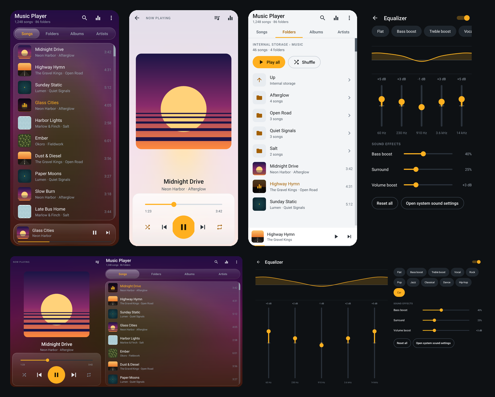
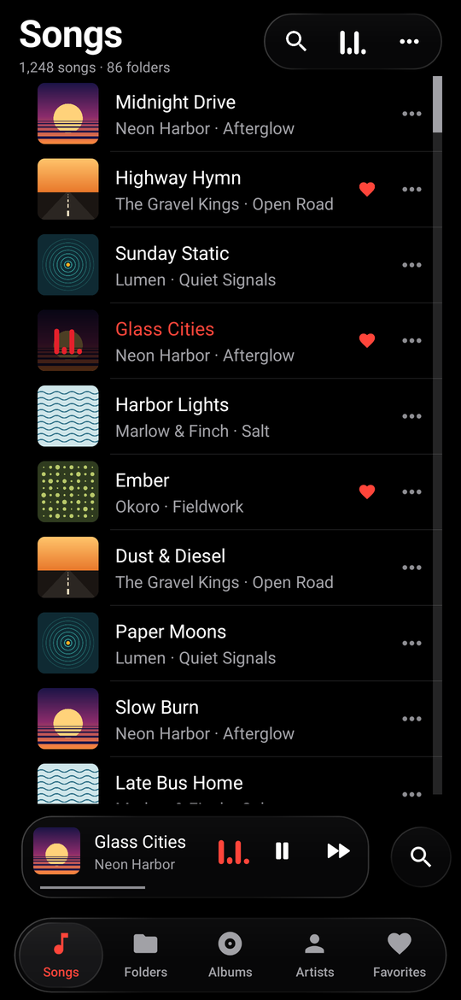
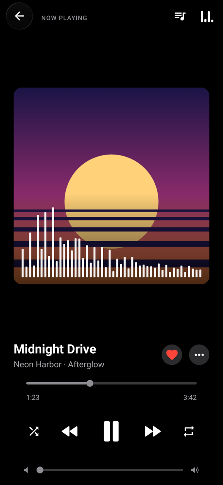
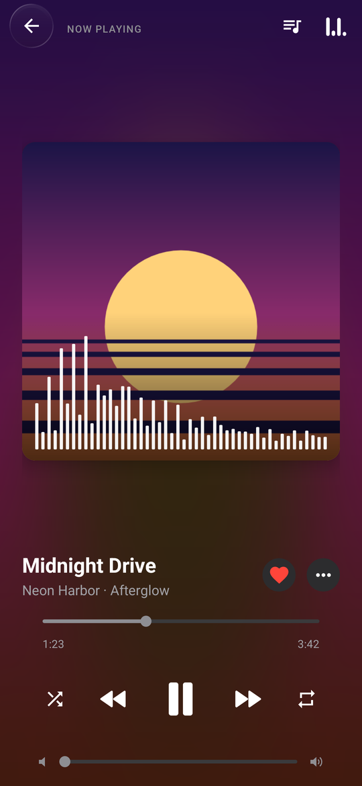
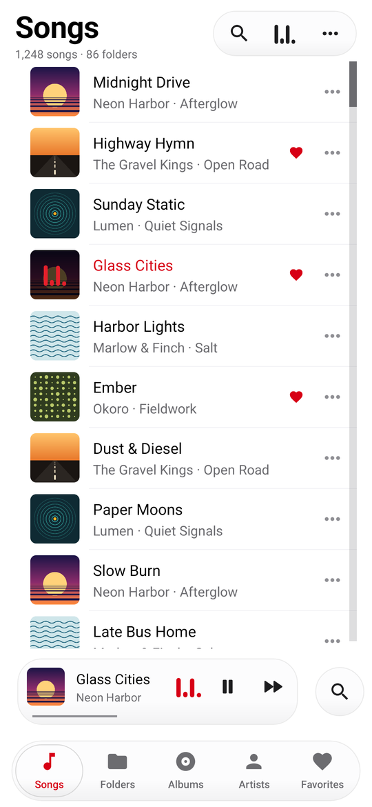
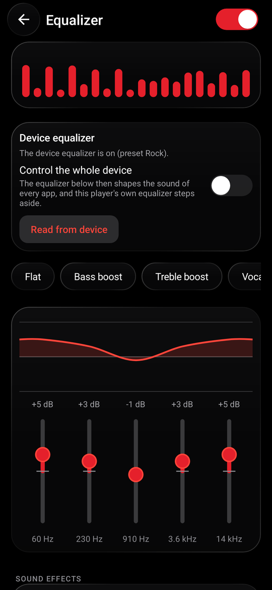
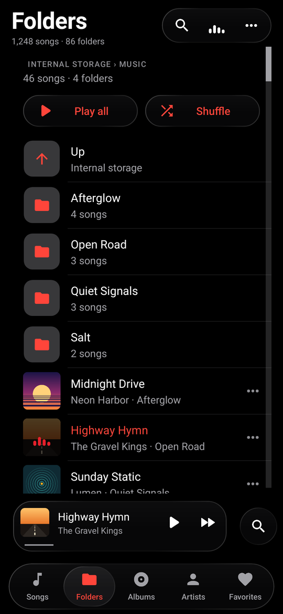
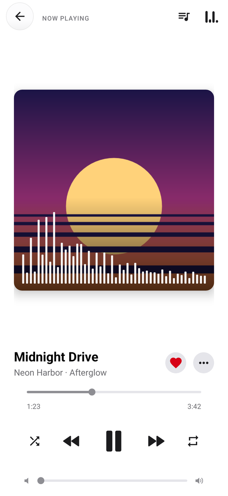
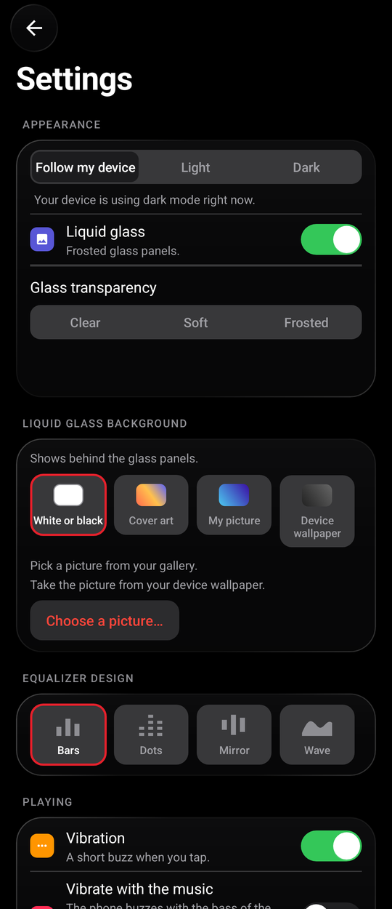
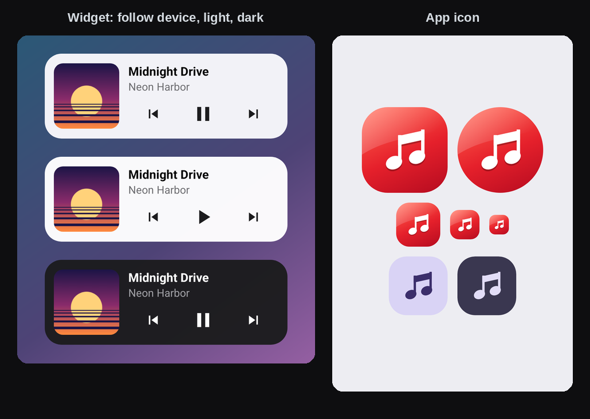

# Music Player

**A small, fast music player for Android phones and car stereos.** 
iPhone Music look &nbsp;·&nbsp; Liquid Glass &nbsp;·&nbsp; every folder &nbsp;·&nbsp; swipe to change songs &nbsp;·&nbsp; vibrates with the bass &nbsp;·&nbsp; updates itself

 

 

  

## Download

| | |
|---|---|
| **Latest version** | **1.25.0**, 14 November 2026 · [what's new](#whats-new) |
| **Get it** | [**MusicPlayer.apk**](https://github.com/mbnetworku/MusicPlayer/releases/latest/download/MusicPlayer.apk) · 204 KB · Android 8.0 or newer |
| **All versions** | [the Releases page](https://github.com/mbnetworku/MusicPlayer/releases) · [version history](#versions) |

**Install it in three steps**

1. **Download** the APK on your phone with the button above. For a car head unit, download it on a computer and copy it to a USB stick.
2. **Open the file.** Android asks once to allow installing from your browser or file manager (*Install unknown apps*): allow it. This is normal for apps that do not come from the Play Store.
3. **Open Music Player** and allow access to your music. That is the only question Android asks at the start.

Good to know:

* **Updates install over the old app and keep your settings.** Every version from 1.7.1 is built by GitHub and signed with the owner's own private key. The app also offers new versions itself, with a pop-up while you use it.
* **Versions before 1.7.1 used a different test key.** If you still have one, uninstall it once and install the latest version. After that, updates install over it.
* It is a young app, checked by 353 automated tests, but not yet tried on many real phones and car stereos. See [Status and limits](#status-and-limits).
* From a computer you can also use `adb install -r MusicPlayer.apk`.

## What's new

**1.25.0**: **None** for the equalizer design (Settings → Equalizer design): no moving bars on the cover, in the mini player or in the lists. And a **redesigned Settings** screen in the New design: rounded groups with coloured icons and rounded segmented choices.

**1.24.0**: a second design, the **iOS Liquid Glass look**. Turn it on in **Settings → Design**: choose **Classic** (the look you know, still the default) or **New**. New has a slim glass tab bar and mini player (Songs, Folders, Albums, Favorites), rounded shapes, a blue accent, white or black icons, and the volume bar right under the buttons, in a car too. The **playing screen has its own choice**, so it can stay Classic while the rest is New. On a car screen the New design puts the player in a rounded glass panel on the left.

**1.23.0**: **Glass transparency** (Clear, Soft, Frosted). The glass is now see-through and not glossy.

**1.22.0**: a round glass search button next to the mini player.

**1.21.0**: round glass back buttons. Shuffle and repeat are white.

**1.20.0**: **the phone vibrates with the bass of the music**: strong for heavy music, nothing for quiet parts.

**1.19.0**: the ambient background drifts slowly, like Apple Music.

**1.18.0**: an **Ambient background** switch. Off is pure black or white.

**1.17.0**: pure black and white background by default.

**1.16.0**: the song list and the player controls sit directly on the background, like on an iPhone.

**1.15.0**: Play and Shuffle on top of the Songs list, and a big letter for each group.

**1.14.0**: **swipe the cover** left or right to change song, and **drag the player down** to close it.

Older changes are in the [version history](#versions) and the [changelog](CHANGELOG.md).

## Versions

Every row is a release you can download. Newest first.

| Version | Date | What changed |
|---|---|---|
| **[1.25.0](https://github.com/mbnetworku/MusicPlayer/releases/tag/v1.25.0)** (latest) | 2026-11-14 | None for the equalizer design. Redesigned Settings in the New design. |
| [1.24.0](https://github.com/mbnetworku/MusicPlayer/releases/tag/v1.24.0) | 2026-11-14 | The New (iOS Liquid Glass) design as an option next to Classic, with its own choice for the playing screen. |
| [1.23.0](https://github.com/mbnetworku/MusicPlayer/releases/tag/v1.23.0) | 2026-11-13 | Glass transparency setting. See-through glass. |
| [1.22.0](https://github.com/mbnetworku/MusicPlayer/releases/tag/v1.22.0) | 2026-11-13 | Round glass search button next to the mini player. |
| [1.21.0](https://github.com/mbnetworku/MusicPlayer/releases/tag/v1.21.0) | 2026-11-13 | Round glass back buttons. White shuffle and repeat. |
| [1.20.0](https://github.com/mbnetworku/MusicPlayer/releases/tag/v1.20.0) | 2026-11-13 | Vibrates with the bass of the music. |
| [1.19.0](https://github.com/mbnetworku/MusicPlayer/releases/tag/v1.19.0) | 2026-11-13 | The ambient background drifts slowly. |
| [1.18.0](https://github.com/mbnetworku/MusicPlayer/releases/tag/v1.18.0) | 2026-11-13 | Ambient background switch. Settings switches keep their own state. |
| [1.17.0](https://github.com/mbnetworku/MusicPlayer/releases/tag/v1.17.0) | 2026-11-13 | Pure black and white background by default. |
| [1.16.0](https://github.com/mbnetworku/MusicPlayer/releases/tag/v1.16.0) | 2026-11-13 | List and controls directly on the background. |
| [1.15.0](https://github.com/mbnetworku/MusicPlayer/releases/tag/v1.15.0) | 2026-11-13 | Play and Shuffle on top of Songs, letter headings. |
| [1.14.0](https://github.com/mbnetworku/MusicPlayer/releases/tag/v1.14.0) | 2026-11-13 | Swipe the cover to change song. Drag the player down to close it. |
| [1.13.0](https://github.com/mbnetworku/MusicPlayer/releases/tag/v1.13.0) | 2026-11-13 | Songs screen in the iPhone Music style. |
| [1.12.0](https://github.com/mbnetworku/MusicPlayer/releases/tag/v1.12.0) | 2026-11-13 | iPhone-style player icons and a volume slider. |
| [1.11.0](https://github.com/mbnetworku/MusicPlayer/releases/tag/v1.11.0) | 2026-11-13 | A fuller Liquid Glass look. |
| [1.10.0](https://github.com/mbnetworku/MusicPlayer/releases/tag/v1.10.0) | 2026-11-13 | Liquid Glass by default, redesigned Settings, update pop-up, automatic releases. |
| [1.7.1](https://github.com/mbnetworku/MusicPlayer/releases/tag/v1.7.1) | 2026-11-13 | The first version signed with the owner's own key. |

Versions 1.0.0 to 1.7.0 were test builds signed with a different key. They are only in the [`download` folder](https://github.com/mbnetworku/MusicPlayer/tree/main/download) and cannot be updated to 1.7.1 or newer without uninstalling first. Their notes are in the [changelog](CHANGELOG.md).

## Why you will like it

* **It looks like Apple Music.** Pure black or pure white pages, large titles, round glass buttons and a floating tab bar, with see-through Liquid Glass panels.
* **It plays every folder.** Songs, Folders, Albums, Artists and Favorites, including music on an SD card or a USB drive.
* **You control it with your fingers.** Swipe the cover to change song. Drag the player down to close it. Sort the list your way.
* **The equalizer moves.** Moving bars on the song that plays, in four designs (or none at all), and the equalizer of your phone is one tap away.
* **Your phone vibrates with the bass.** An option, off until you turn it on.
* **It updates itself.** A pop-up tells you when a new version is out.
* **It is tiny.** About 187 KB, plain Java, no libraries, no ads, no account.

## Screenshots

These are renders of the real screens with made-up songs and generated covers.

<table>
<tr>
<td align="center"> <b>Songs</b></td>
<td align="center"> <b>Now playing</b></td>
<td align="center"> <b>Ambient background</b></td>
</tr>
<tr>
<td align="center"> <b>Light look</b></td>
<td align="center"> <b>Equalizer</b></td>
<td align="center"> <b>Folders</b></td>
</tr>
<tr>
<td align="center"> <b>Now playing, light</b></td>
<td align="center"> <b>Settings</b></td>
<td align="center"> <b>Widget</b></td>
</tr>
</table>

## Using it

| You want to | Do this |
|---|---|
| Play a song | Tap it. The list it came from (all songs, a folder, an album) becomes the queue. |
| Play a whole folder, album or artist | Open it and tap **Play** or **Shuffle**. |
| Change song | On the player, **swipe the cover** left for the next song and right for the previous one. |
| Close the player | **Drag it down**, or tap the round back button. |
| Change the volume | Use the slider at the bottom of the player (phones and tablets), or the volume buttons. |
| Add to the queue, delete, see details | Tap the **⋯** at the end of a song, album, artist or folder (or long-press it). |
| Sort the songs | Menu (⋯) → **Sort songs**: title, artist, album, recently added or longest first, and reverse. |
| See or edit the queue | Open the player, then the queue icon. Tap to jump, long-press to remove. |
| Search | Tap either magnifier. It searches title, artist, album and file name. |
| Use the equalizer | Tap the equalizer icon. Picking a preset or moving a slider turns it on. |
| Change the look, vibration or the ambient background, or check for updates | Menu (⋯) → **Settings**. |
| Find music that is not listed | Menu (⋯) → **Scan storage for music**. |

The app remembers your queue and position and carries on where you left off.

### On a car head unit

* Install the APK from a USB stick, then put your music on a USB drive or SD card. If it does not appear after plugging it in, use **Scan storage for music**.
* On screens at least 640 dp wide and 400 dp tall in landscape (most head units), the player sits on the left and the library on the right. Rows are larger and the play button is 96 dp. The volume slider is hidden there, because a car has its own volume.
* Steering-wheel keys, Bluetooth and headset buttons send standard media keys, which the app handles (not yet verified on a real head unit).
* The equalizer uses the audio effects built into Android. Some head units process sound in their own DSP instead; the screen says so when Android's equalizer is not available.
* Updates need the head unit to be online and to let apps install packages. Where that is blocked, install new versions from a USB stick as before.

## Features in detail

<b>Library, search and sorting</b>

* **Five tabs:** Songs, Folders, Albums, Artists and Favorites. Folders shows every storage volume, including USB drives.
* **Songs** has **Play** and **Shuffle** on top and a big letter for each group (when sorted by title). The quick letter index on the right still works.
* **Sort songs** (menu): title, artist, album, recently added, longest first, and reverse. The choice is kept and used in Songs, search and folders.
* **Favorites:** tap the heart on the player, or use the menu of any song.
* **Delete songs for good** from the menu, with a question first. Android 11 and newer asks you to confirm each delete.

<b>The player</b>

* The cover colours the screen when the ambient background is on. Moving bars over the cover show the music in one of four designs, or you can turn them off.
* **Swipe the cover** left or right to change song. The cover follows your finger and the next one slides in. You can turn this off in Settings.
* **Drag the player down** to close it. The sliders keep their own drag.
* A **volume slider** with speaker icons follows the phone's music volume.
* iPhone-style play, pause, previous and next icons. Shuffle and repeat are dim when off and bright when on.

<b>Equalizer and the moving bars</b>

* The **Equalizer** screen reads and controls the equalizer built into your phone (best effort: many devices do not let an app see it, and the screen then says so).
* The **moving bars** on the playing song and on the cover are an animation made to look like a spectrum. They are not measured from the sound, so the app needs no microphone permission.
* **Equalizer design** in Settings: **Bars**, **Dots**, **Mirror**, **Wave** or **None**. It changes the bars everywhere. **None** turns the moving bars off on the cover, in the mini player and in the lists. The equalizer button is always in the top corner, and it stays as a still picture.

<b>Looks, Liquid Glass and the ambient background</b>

* **Theme:** Follow my device, Light or Dark. The pages are pure black in dark mode and pure white in light mode.
* **Liquid glass:** see-through panels with a thin bright edge: the capsule at the top, the mini player, the round buttons and the tab bar. It is on by default.
* **Glass transparency:** **Clear** (the default), **Soft** or **Frosted**. Pop-ups stay solid so the text is easy to read.
* **Ambient background** (switch): the colours of the song that is playing fill the background and drift slowly, like Apple Music. They only move while the screen is in use, and not at all if the phone's animations are off.
* **Background tiles:** white or black, the song's cover, your own picture, or your device wallpaper.
* Android cannot blur what is behind a panel, so the glass is see-through but not blurred like on an iPhone.

<b>Vibration</b>

* **Vibration** (on by default): a short buzz when you tap a song, a button or a tab. It also follows Android's own touch feedback setting.
* **Vibrate with the music** (off until you turn it on): the phone buzzes on the strong low notes of the song, the drums and the bass. Heavy music gives a strong buzz and quiet parts give none. When a song starts, the app reads the song file once in the background and measures its bass. It does not use the microphone and records nothing. A song the phone cannot read gives no buzz.

<b>Settings</b>

| Group | Setting | What it does |
|---|---|---|
| Appearance | Follow my device, Light, Dark | The theme. |
| Appearance | Liquid glass | The glass look. |
| Appearance | Glass transparency | Clear, Soft or Frosted. |
| Appearance | Ambient background | Colours from the song fill the background. |
| Background | Tiles | White or black, the cover, your picture, or your wallpaper. |
| Equalizer design | Tiles | Bars, Dots, Mirror, Wave or None. |
| Playing | Vibration | A short buzz on taps. |
| Playing | Vibrate with the music | The phone buzzes with the bass. |
| Playing | Swipe the cover to change song | Swipe left for next, right for previous. |
| Library | Show all audio files | Include ringtones, voice notes and other short sounds. |
| Library | Scan storage for music | Index new files on internal storage, SD cards and USB drives. |
| Updates | Check for updates, Check automatically | Look for a newer version on GitHub. |

<b>Widget and icon</b>

* A home-screen widget with the song, the cover and play controls. Its style can be changed.
* An adaptive app icon, with a single-colour version for Android 13 themed icons.

<b>Updates</b>

* A **pop-up** tells you once for each new version, while you use the app. **Update now** downloads it and opens Settings to install. **Later** closes it.
* **Settings → Updates** also shows the notes of the new version and a **Check for updates** button.
* The app looks at GitHub's Releases page, downloads the APK, checks its checksum and hands it to Android's installer. Android asks you to confirm every install.
* **Updates are published automatically:** when a new version number is pushed to GitHub, GitHub builds, tests, signs and publishes it by itself.

## Permissions

| Permission | Why |
|---|---|
| `READ_MEDIA_AUDIO` (Android 13+), `READ_EXTERNAL_STORAGE` (Android 12 and older) | Read your music files. This is the only question Android asks at the start. |
| `FOREGROUND_SERVICE`, `FOREGROUND_SERVICE_MEDIA_PLAYBACK` | Keep playing with the screen off. |
| `POST_NOTIFICATIONS` | The playback controls in the notification area (Android 13+). The app does not ask for it at the start; turn it on in Android's settings for this app if you want it. |
| `WAKE_LOCK` | Stop the CPU sleeping in the middle of a song. |
| `MODIFY_AUDIO_SETTINGS` | Standard permission for apps that use audio effects. |
| `VIBRATE` | The vibration options. Android grants it without asking. |
| `WRITE_EXTERNAL_STORAGE` (Android 10 and older only) | Delete songs. Android 11 and newer never grant it and ask per delete instead. |
| `INTERNET` | Only to look for updates and download them from GitHub. |
| `REQUEST_INSTALL_PACKAGES` | Only so Android lets the app hand a downloaded update to the installer. |

**There is no microphone permission.** The app never listens to the microphone and records nothing.

## Status and limits

* **Checked:** 353 automated tests, Android lint, and a release build whose version, signature and permissions were inspected with `apksigner` and `aapt2`. The screens were rendered in every look.
* **Not yet run on many real phones or car stereos.** Actual sound output, the hardware equalizer, notifications, head-unit details, and how the new features feel on a real device have not been checked. This includes swiping the cover, dragging the player down, the volume slider, the ambient drift and the New design (which was checked by tests and by renders of the real screens, not on a real phone or car stereo).
* **Vibrating with the music** reads each song file once, which uses some battery. Its strength control depends on your phone: a phone that cannot vary the strength buzzes at one strength.
* The glass look is see-through but not blurred (see above).
* The device equalizer is best effort: many devices do not let an app see or change it. Controlling it affects every app and lasts only while Music Player runs.
* Reading the wallpaper *picture* is not possible on the newest Android versions; the wallpaper's colours are used instead.
* Gapless playback is not implemented; there is a short gap between songs.
* Android Auto and Android Automotive OS are not supported.
* Opening a single audio file from a file manager ("Open with") is not supported yet. Songs must be in MediaStore.

Ideas for later: playlists, sleep timer, gapless playback, Android Auto browsing, delta updates, a resizable widget with a progress bar.

## For developers

* [docs/DEVELOPING.md](docs/DEVELOPING.md): building from source, tests, signing and how the code is organized.
* [CHANGELOG.md](CHANGELOG.md): what changed in each version.
* **Releasing:** raise the version in `app/build.gradle`, add an entry to `CHANGELOG.md` and push to `main`. The workflow *Publish release* builds, tests, signs (with the key in the repository secrets) and publishes the release by itself.
* The `tools` folder has two Windows helpers: `Setup-Signing-Key.bat` makes a private signing key and adds it to GitHub, and `Publish-Signed-Update.bat` starts a release by hand.
* The app is plain Java on Android framework APIs only (no libraries), which is why it is so small.

## Credits

Icons are from [Material Icons](https://fonts.google.com/icons) (Apache License 2.0). Screenshots use generated cover art and fictional song names.
